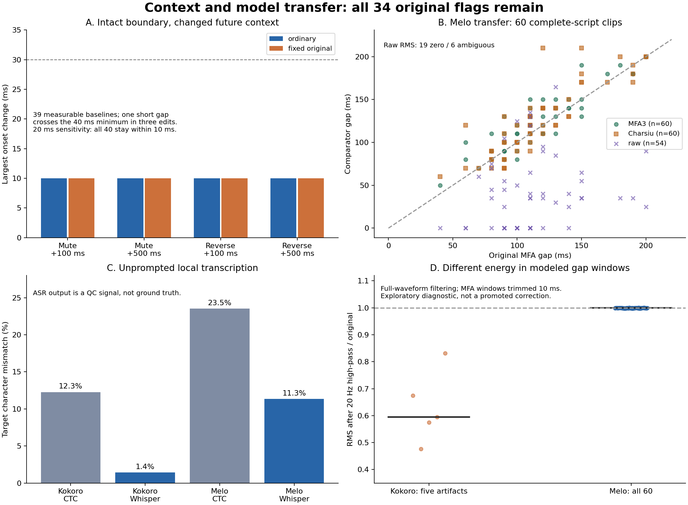

# Context and model transfer: decision brief

Local continuation on 15 November 2026 (America/Indianapolis), beginning 19:15.
All 34 original flags remain. No human annotation, billed inference, training,
system installation, driver changes, publishing, or main-study run took place.

The next consequential choice is whether to proceed with **exploratory,
model-estimated phonetic timing** while absolute accuracy remains unresolved,
or keep independent boundary validation as the prerequisite for timing claims.
I recommend keeping the current recordings as an intact diagnostic set and
allowing only explicitly exploratory method comparisons. Do not clear the 34
flags, select the six passes as a study corpus, or call an aligner ensemble truth.
Redefining the primary outcome as waveform quiet is a different scientific target
and requires an explicit decision. Further model agreement alone will not settle
which natural phonetic endpoint is correct.

[All 100 audio/transcript comparisons](context-transfer-clips.html) retain every
recording. [Original 40 boundary plots](second-aligner-clips.html) and the
[earlier investigation](second-aligner-investigation.md) remain available.

## What changed in our understanding

1. **Distant future context is not causing large boundary shifts in this test.**
   Preserve the entire existing CTC search bracket plus 100 or 500 ms, then mute
   or reverse the remaining audio. Charsiu's 39 measurable onsets move at most
   10 ms under both ordinary and fixed-original input normalization. One 30 ms
   baseline gap crosses its 40 ms minimum under three edits; with the predeclared
   20 ms minimum all 40 endpoints/gaps stay within 10 ms. Streaming Silero's
   protected-prefix probabilities and all boundary outputs remain identical.
   This narrows, but does not erase, the earlier local-muting anticipation result.

2. **The disagreement recurs in another synthesis family, with a different pattern.**
   MeloTTS generates 60 complete-script recordings: the same ten joke/control
   pairs, one stock Chinese voice, three paired seeds. No sentence concatenation
   or wrapper-added pause is used. MFA2/MFA3 ending onsets agree within 30 ms in
   60/60; MFA2/Charsiu in 58/60. Yet raw-RMS QC flags 51/60 recordings.
   Among the 35 unique raw intervals, its setup offset is on average 66.9 ms later
   than MFA2; its ending onset differs by 23.7 ms on average in absolute value.
   The earlier Kokoro disagreements concentrated at ending onset. Therefore a
   single fixed detector offset is not supported across these recordings.

3. **Melo's modeled gaps are not dominated by the same slow drift.**
   In a post-hoc diagnostic, apply a fixed fourth-order 20 Hz high-pass to each
   complete waveform, then measure RMS inside MFA2 windows trimmed by 10 ms at
   each edge. Melo retains 99.72–100.08% of RMS (median 99.93%). The original five
   Kokoro artifact cases retain 47.60–83.09% (median 59.48%). These are local RMS
   ratios, not additive spectral-energy percentages. Filter transients and model
   window error can matter; the filter is not a validated correction. Earlier
   known-gap failures still prohibit promoting it.

4. **Independent ASR supports the original transcripts more strongly than the transfer set.**
   Local Whisper large-v3-turbo transcribes every clip without the target text or
   an initial prompt. Raw character mismatch is 1.42% for Kokoro and 11.33% for
   Melo. The post-hoc two-character neighborhood on each side of the original
   boundary has zero Whisper mismatches in all 40; Melo has such mismatches in
   14/60. This is useful QC, not a timestamp reference or verified pronunciation
   judgment. Melo remains a diagnostic transfer set, not a validated replacement.

## Complete transfer accounting

All 60 clips are present in all three phonetic aligners. Differences below compare
each method with saved MFA2; no method is a gold standard. Gap MAE includes numeric
zero when the waveform method finds no qualifying interval. Missing ambiguous
intervals are retained in the denominator when reporting overall QC.

| Comparator | Numeric gaps | Unique waveform intervals | Gap MAE vs MFA2 | Within 30 ms among numeric gaps |
|---|---:|---:|---:|---:|
| MFA3 | 60 | n/a | 11.67 ms | 56/60 |
| Charsiu | 60 | n/a | 14.67 ms | 56/60 |
| Raw RMS | 54 | 35 | 75.39 ms | 9/54 |
| Frame-mean-corrected RMS | 53 | 34 | 75.21 ms | 10/53 |
| Frame-linear-detrended RMS | 53 | 36 | 72.29 ms | 10/53 |

Raw RMS: 35 unique, 19 no qualifying interval, six ambiguous. Frame mean correction:
34 unique, 19 no interval, seven ambiguous. Linear correction: 36 unique, 17 no
interval, seven ambiguous. No missing value becomes zero. The native 44.1 kHz
waveform is retained for RMS; the nominal 10/5 ms frame/hop rounds to 441/220
samples. The selector retains its existing 5 ms interval-edge convention.

Median three-take gap ranges across 20 texts are 30 ms (MFA2), 30 ms (MFA3), and
25 ms (Charsiu); maxima are 80, 60, and 70 ms. These include actual synthesis
variation plus measurement variation. They are not confidence intervals.

## Transcript QC

Both recognizers see audio, not the target script. Mandarin language is specified
for Whisper, with greedy decoding, one whole clip, no target prompt and no
timestamp use. No output reaches its token cap. Character mismatch ignores
punctuation by retaining Han characters; traditional/simplified writing and
homophones remain potential differences. Toned-pinyin conversion is lexical,
not an acoustic assessment of tone sandhi or polyphonic pronunciation.

| Family | Clips | CTC character mismatch | Whisper character mismatch | CTC toned-pinyin mismatch | Whisper toned-pinyin mismatch |
|---|---:|---:|---:|---:|---:|
| Kokoro | 40 | 12.25% | 1.42% | 4.25% | 0.42% |
| Melo | 60 | 23.51% | 11.33% | 17.04% | 8.40% |

Whisper matches all target Han characters in 30/40 Kokoro recordings and 1/60
Melo recordings. Post-hoc toneless pinyin mismatch is 0% and 6.19%, respectively;
this deliberately removes tone information and is not a new acceptance rule.
Both recognizers make the same toned-pinyin substitution/deletion at six target
positions across six Kokoro clips (all tone-only differences), and at 59 positions
across 38 Melo clips. This increases concern about transfer stimulus fidelity,
but two recognizers can share errors. No stimulus or transcript was repaired,
excluded, or declared correct by consensus. Brackets still use the original CTC
alignment, which limits the transfer analysis when transcript fidelity is uncertain.

## How to handle the original 34

| Group | Supported interpretation | Current handling |
|---|---|---|
| 29 onset disagreements | Three phonetic models corroborate early onsets; waveform thresholds miss weak regions. Distant-context edits are stable, but local muting showed contextual anticipation. | Preserve original MFA estimates as provisional, retain flags and method comparisons. Do not replace them with raw-RMS onsets or an averaged consensus. |
| Five fragmented waveform cases | Slow energy is native to Kokoro and tied to vocoder conditioning; simple corrections and style interventions have unresolved validity or alter speech. | Preserve originals and flags. Keep transformed versions as diagnostics; no repair is promoted. |
| Six prior passes | Their prior duration criterion still passes; this does not establish all endpoints or define a valid subset. | Retain in the same 40-clip diagnostic set; no selective study sample. |

An existing independently labeled corpus could calibrate an aligner without
requesting new annotation, but its labels would not directly establish the true
boundaries in these 34 synthetic recordings. A new model family or another
threshold sweep can add robustness evidence; neither should silently become a
replacement for the original validity requirement.

## Provenance and reproducibility

The [declared plan](../docs/context-transfer-plan.md) separates fixed experiments
from the post-hoc high-pass/toneless/local-transcript descriptions. The
[reproduction guide](../docs/context-transfer-reproduce.md) lists commands and
historical plan snapshots. Numeric source tables are in
`runs/future-context-analysis-v1`, `runs/transfer-analysis-v1`, and
`runs/context-transfer-qc-v2`. The v1 QC summary used the wrong category label for
the five-case high-pass aggregate (n=0); v2 fixes that lookup with an explicit
five-case assertion and adds the labeled post-hoc transcript summaries. The v1
files/source are preserved; all shared ASR aggregate numbers remain identical.

The first context-preparation attempt failed from a manifest argument-name
collision before recording any item. It is retained as `future-context-audio-v1`;
the completed 200-waveform set is v2. The first Melo BERT load audit rejected
unused pooling/next-sentence heads; the final audit allows only those unused
heads and requires every encoder weight. Failed-probe records remain intact.

Melo uses pinned official MIT [code](https://github.com/myshell-ai/MeloTTS) and
[Chinese weights](https://huggingface.co/myshell-ai/MeloTTS-Chinese), with its native
Apache-2.0 [multilingual BERT dependency](https://huggingface.co/google-bert/bert-base-multilingual-uncased).
The [ordinary wrapper](https://github.com/myshell-ai/MeloTTS/blob/main/melo/api.py)
splits text and appends chunk silence, so this probe calls the native model once
per complete script. All 20 Chinese frontends match pinned upstream functions;
fast and slow tokenizers give identical input IDs with no unknown token.
The stock ZH speaker is ID 1 in the pinned configuration. BERT hidden layer -3,
native language/tone/blank expansion, speed 1, and native noise settings are used.

MIT [Whisper large-v3-turbo](https://huggingface.co/openai/whisper-large-v3-turbo)
is pinned at `41f01f3fe87f28c78e2fbf8b568835947dd65ed9` and uses existing local
Transformers/PyTorch packages. Peak task-owned GPU allocation during the 100-clip
Whisper run was about 1.60 GiB. Other GPU workloads were not stopped or changed.
No new package/runtime install was required in this continuation. Model locks
contain exact revisions, file sizes and hashes; all assets remain project-local.

The [verification record](../runs/context-transfer-report-v1/verification.json)
checks saved manifests, original metrics, exact future-edited waveform
construction, model files, provenance inputs and local viewer links. The
[download inventory](../runs/context-transfer-report-v1/downloads.json) combines
the earlier 2.95 GB with new Melo/BERT/Whisper assets against the 15 GB allowance.
It describes retained download evidence, not metered network traffic.
