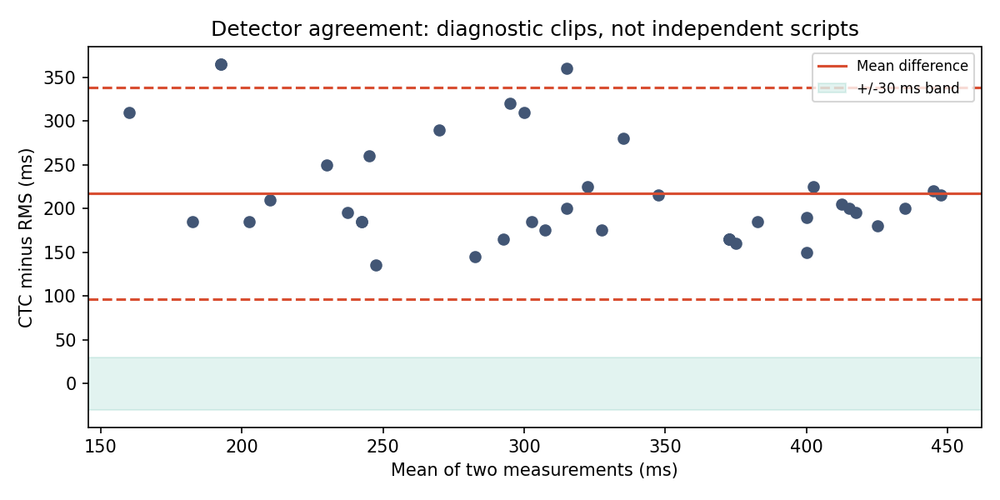

# Local exploration — 2026-11-14

**GPU inference works; this is a diagnostic run, not a completed study or an accepted Gate 1.**

Generated 40 Mandarin clips: ten public-domain joke adaptations and their matched controls, each spoken by two stock voices from **one** Kokoro model. No human annotation, paid inference, cloned voice or downloaded performance media was used. All lengths and punctuation positions match; semantic adequacy remains unreviewed.

Two local Qwen2.5 language models retained **5/10** original pairs under the rule that the joke ending must have greater summed conditional surprisal in both models. Retained IDs: zh001, zh002, zh003, zh007, zh009. These are two sizes of one family, so agreement is not independent-family replication. Audio for all candidates is retained solely for pipeline diagnostics.

The aligner produced 40/40 measurements. CTC minus RMS bias was **217.4 ms**, MAE **217.4 ms**, and **0.0%** were within 30 ms. Bland–Altman limits were 96.3 to 338.4 ms. Neither detector is ground truth; these clips are paired/repeated observations, not independent validation subjects.

| Stock voice | Clips | CTC − RMS bias, ms | MAE, ms | Within 30 ms |
|---|---:|---:|---:|---:|
| zf_001 | 20 | 179.7 | 179.7 | 0.0% |
| zm_010 | 20 | 255.0 | 255.0 | 0.0% |

RMS tone fixtures: 24/24 within 30 ms. Actual-speech insertion tests: 12/12 passed both detectors. Durations were 0, 30, 100, 300, 600 and 1000 ms, on the first joke in each stock voice. These tests measure **incremental gap recovery**, not absolute phonetic-boundary accuracy. The insertion point was selected automatically inside a low-energy interval; no human reference is available.

GPU: RTX 4090 Laptop, 16,376 MiB; PyTorch 2.8.0+cu128, CUDA runtime 12.8, existing driver 581.95. Generated 343.8 s audio in 5.0 s timed inference, including the first-call warmup and excluding model load/download. Peak synthesis allocation: 728 MiB; this is PyTorch allocation, not whole-device usage. This does not project runtime for other speech models.

Methods: complete-script Mandarin phonemization followed by one inference, fixed speed 1.0, seed 20261114 and one diagnostic take. CTC Viterbi alignment uses 20 ms frame stride and explicit repeated-label constraints. Character-emission support is only an acoustic-boundary proxy. RMS uses 10 ms frames, 5 ms hop, a threshold 35 dB below the clip’s 95th-percentile RMS, a 1e-6 floor, and an internal interval within 50 ms of the CTC gap midpoint. Thus energy values are independent of alignment emissions, but the search location is alignment-assisted. Terminal padding is excluded.

All original setup boundaries are commas in this small set. The diagnostic cannot identify punctuation interactions, and no normalized-punctuation audio or performed-style condition has been run. The two voices share one TTS model. The run does not test 60 retained pairs, English, four to six speech models, multi-take variability, surprise coupling, or funniness. Do not interpret a joke-minus-control estimate before resolving measurement validity.

Next automated work: investigate/refine the acoustic boundary definition and threshold sensitivity, enlarge the candidate corpus before applying the fixed LM filter, and add a distinct speech-model family with style control. Human split/boundary review remains deferred. Gate 2 and the main run have not started.

Reproduction: see [README](../README.md). Exact model commits and artifact hashes are in [model locks](../runs/model-locks/); raw audio remains local and ignored by Git. [Static audio comparisons](diagnostic-audio.html), [silence tests](../runs/kokoro-diagnostic-v1/silence-validation/summary.json), [retention table](../runs/surprisal-v2/retention.json), [related work](../docs/related.md), and [novelty search](../docs/novelty-search.md).
