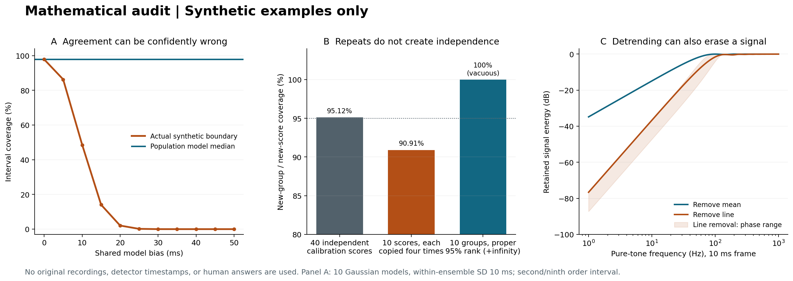

# Mathematical research for the unresolved pause boundaries

Research cutoff: **18 November 2026**. This is a focused primary-source review,
with mathematical derivations and local synthetic checks. It is not an exhaustive
systematic review. No clip-specific detector timestamps or participant answers
appear here. The active blinded practice and historical study decisions are unchanged.

## What changes our next decision

The strongest direction is to **estimate a defensible boundary region and carry
it through the analysis**, rather than require every flagged clip to have one
precisely correct timestamp. Recent work supplies useful tools for direct boundary
prediction, interval-valued observations and dependent calibration data. None
automatically validates our Mandarin synthetic speech.

Our own analysis gives four practical conclusions:

1. A silent stop closure and the preceding pause can sometimes be acoustically
   indistinguishable. A boundary convention or an unresolved region is then
   necessary; a larger model cannot recover information absent from the recording.
2. Model agreement and successful pause insertion tests can both conceal shared
   absolute bias. They answer narrower questions than natural-boundary accuracy.
3. The five low-frequency cases are a nuisance-separation problem. Removing a
   nuisance subspace also removes any genuine signal in that subspace.
4. A timing contrast can sometimes be determined even while individual boundaries
   remain uncertain. We should calculate its worst-case range before deciding
   that every flagged clip needs further work.

The current human protocol already supports this approach: earliest/best/latest
marks, explicit closure ambiguity, listening judgments, and hidden repeats. It
should continue unchanged during practice. Proposed extensions below are for a
subsequent analysis/protocol revision, before scored outcomes are inspected.

## Recent research that matters

Dates distinguish original submissions from revisions. Unless noted otherwise,
the status verified here is an arXiv preprint, not confirmed journal acceptance.
Reported benchmark performance is the authors' evidence, not a replication in
this project. Each applicability judgment is our inference.

| Work and verified date | Contribution | Relevance and limitation here |
| --- | --- | --- |
| [Zolkepli, *Where Words Begin and End*](https://arxiv.org/html/2610.17782v2), submitted 13 Oct 2026; v2 19 Oct | Finds spurious word gaps from CTC emission timing; trains Whisper to predict timestamp tokens using human boundaries. | Closely matches our initial measurement-definition failure. A promising different training target, but its pilot human references are English and its later tests share training-corpus conventions. This does not establish accuracy on Mandarin Kokoro. |
| [Wagner & Zusag, *Noise-Robust Forced Alignment for Spontaneous Speech*](https://arxiv.org/html/2610.22583v1), 15 Oct 2026 | Combines WavLM features, a GMM-HMM, a projection learned from clean/noisy feature pairs, and explicit nonlexical event units. | Supports separating nuisance energy and vocal events from speech boundaries. Its English phone inventory and external-noise training do not directly solve Mandarin vocoder baseline wander. |
| [Kelley, *Gradient boundaries through confidence intervals…*](https://arxiv.org/html/2506.01256v4), originally Jun 2025; v4 13 Apr 2026, arXiv marked accepted | Ten neural classifiers give a median boundary and an order-statistic interval. | Provides a useful model-uncertainty representation. The author explicitly distinguishes uncertainty of the model median from the true phonetic boundary. Our heterogeneous aligners are not that ten-model experiment. |
| [Rousso, Cohen & Keshet, *Fully Differentiable Neural Forced Alignment via Soft Dynamic Programming*](https://arxiv.org/html/2606.25460v1), 24 Jun 2026 | FALCON combines acoustic transition features, phoneme consistency and differentiable dynamic programming. | Strong architectural lead for separating transition evidence from transcript pressure. Reported transfer includes Dutch, German and Hebrew, not a verified Mandarin test. Soft outputs are not automatically calibrated uncertainty. |
| [Weber et al., *Multilingual Word-Level Forced Alignment…*](https://arxiv.org/abs/2606.10675), 9 Jun 2026; author repository identifies Interspeech 2026 | MWA fuses MMS representations with an unsupervised boundary detector and learned segmental dynamic programming. | Another boundary-aware candidate. Its tested unseen languages are Dutch, German and Hebrew; broad MMS language support is not equivalent to demonstrated Mandarin timing precision. |
| [Liu, de Paula & Tamer, *Prediction Sets and Conformal Inference with Interval Outcomes*](https://arxiv.org/html/2501.10117v5), originally Jan 2025; **v5 11 Nov 2026** | Develops prediction sets under interval censoring and partial identification, including disjoint sets and a conformal interval-containment score. | The closest mathematical match to earliest/latest annotations. Our elicited plausible ranges are not guaranteed censoring bounds; applying its interpretation requires an additional annotation-coverage assumption. |
| [Hore & Ramdas, *Conformal changepoint localization*](https://arxiv.org/abs/2602.06267), Feb 2026; v2 27 Jul | CONCH constructs finite-sample confidence sets for a single change using exchangeability within each regime. | Attractive alternative to a point-valued threshold crossing. Correlated speech frames, gradual transitions and multiple adjacent phone changes do not automatically satisfy the theorem. |
| [Peng et al., *ARC: Augmented-Rank Conformalization…*](https://arxiv.org/abs/2608.08424), 9 Aug 2026 | Rank-based changepoint scores preserve sets under strictly increasing marginal transformations. | Useful robustness idea for gain/scale changes. The paper explicitly excludes general serial dependence and trend-type alternatives from exact validity. Baseline drift is therefore not covered merely by choosing ranks. |
| [Mallick et al., *Generalized Hierarchical Conformal Prediction*](https://arxiv.org/html/2608.15500v1), 16 Aug 2026 | Addresses grouped prediction after observing some data from a new group, using a randomized reference-group-size construction. | Relevant to future repeated takes or partially calibrated voices. Its group exchangeability, group-size ignorability and conditional within-group iid assumptions need examination; fixed joke/control/voice combinations are not automatically iid. |
| [Lee, Foygel Barber & Willett, *Distribution-free inference with hierarchical data*](https://arxiv.org/abs/2306.06342), foundational preprint 2023; v4 2 Aug 2025 | Extends predictive inference to hierarchical exchangeability and repeated measurements. | Supplies the relevant dependence framework. We must define whether the target is another take, another script, or another voice/model family; these are different prediction tasks. |

### What is actually available to try

FALCON has an [official repository](https://github.com/MLSpeech/FALCON) with a
declared MIT license and checkpoint directories. MWA also has an
[official implementation](https://github.com/MLSpeech/Multilingual-Word-Aligner).
No new checkpoint was downloaded or executed during this review. Mandarin phone
mapping, checkpoint-specific terms, dependencies and existing-fixture behavior
still require checking before either becomes a project experiment.

The October Whisper paper names released large-v3/turbo models and CC BY-NC
terms. Its limitations also acknowledge unresolved licensing of some training
corpus mirrors. The linked model card was inaccessible through the research
tool, so release availability and the complete checkpoint terms were not
independently verified. Treat this as a promising paper, not an already vetted
installation recommendation. [Paper and limitations](https://arxiv.org/html/2610.17782v2)

I would prioritize a verified boundary-supervised model over another CTC
timestamp wrapper, because it changes the evidence used for the boundary.
Architectural diversity alone still cannot prove that two models lack shared bias.

## 1. Define the quantity before estimating it

Let \(S\) denote the end of speech belonging to the setup and \(E\) the start of
speech belonging to the ending, under the frozen phonetic convention. Define

\[
G=E-S.
\]

This phonetic gap is distinct from a threshold-defined quiet interval and from
a listener's perceived pause. A threshold measurement also depends on frame
length, frequency weighting, nuisance correction and threshold. A perceptual
measurement depends on the listener, context and playback. Agreement among
these quantities is an empirical question, not an identity.

A useful observation model is

\[
x(t)=s(t;S,E,\phi)+b(t)+\epsilon(t),
\]

where \(\phi\) describes phone realization/context, \(b\) is an unwanted smooth
component, and \(\epsilon\) is residual noise. Neither energy nor text alone
determines which part belongs to the word.

### A precise nonidentifiability result

Suppose two admissible descriptions assign ending starts \(E_0\) and \(E_1\),
separated by \(d\), but induce exactly the same distribution of observed audio.
For example, reallocating a genuinely silent span between pause and unobserved
stop closure can leave the recording unchanged. This is a conditional example,
not a finding that all 29 disputed onsets are unidentifiable.

For any estimator \(\widehat E(x)\), the triangle inequality gives

\[
|\widehat E-E_0|+|\widehat E-E_1|\ge d.
\]

Taking expectations under the common observation distribution proves

\[
\max_{j\in\{0,1\}}\mathbb E_j|\widehat E-E_j|\ge d/2.
\]

Thus a synthetic 60 ms ambiguity has at least a 30 ms worst-case expected
absolute error, however sophisticated the estimator. The midpoint attains the
bound in the two-point example; it does not reveal which description is true.

There is a corresponding set result. If a confidence set covers each possible
boundary with probability at least \(1-\alpha\), then, under their common data
distribution, it contains both with probability at least \(1-2\alpha\), by the
union bound. Its diameter must therefore be at least \(d\) that often. A narrow
uniformly reliable interval is impossible in this example.

An operational convention can define an observable landmark, such as a release
burst, but this changes the estimand if the intended target was phone start.
The existing protocol correctly permits closure ambiguity instead of quietly
making that substitution. Weak frication or aspiration is different: it can
provide genuine boundary evidence even when a simple RMS rule misses it.

## 2. What our validation experiments can and cannot establish

### Insertion recovery is insensitive to constant bias

Write a measured gap as \(\widehat G(x)=G(x)+b(x)\). If an ideal transformation
\(T_d\) inserts exactly \(d\) of gap without altering the target definition,

\[
\widehat G(T_dx)-\widehat G(x)-d=b(T_dx)-b(x).
\]

A constant 100 ms bias cancels perfectly. A flawless incremental recovery test
therefore does not establish absolute accuracy. Hard splices add a second issue:
they may remove genuine phone material while the forced transcript still
requires that phone. This explains why both absolute and incremental fixtures
were needed, and why neither constitutes natural-speech ground truth.

### Duration agreement can hide endpoint error

With endpoint errors \(e_S=\widehat S-S\), \(e_E=\widehat E-E\),

\[
\widehat G-G=e_E-e_S,\qquad
\operatorname{Var}(\widehat G-G)=\operatorname{Var}(e_E)+
\operatorname{Var}(e_S)-2\operatorname{Cov}(e_E,e_S).
\]

Moving both endpoints equally preserves the duration exactly. This is why our
human analysis must assess both endpoints and the gap, as already specified.

### Ensemble precision is not absolute accuracy

For a common-bias model \(\widehat E_m=E+B+\epsilon_m\), with mutually independent
zero-mean \(\epsilon_m\) independent of \(B\),

\[
\operatorname{Var}(\overline E-E)=\sigma_B^2+\sigma_\epsilon^2/M.
\]

More models reduce the second term, not the first. Across-model spread on one
clip mostly measures the model-specific component. If \(B\) is a fixed bias,
the mean squared error instead contains \(B^2\). A shared bias can arise even
when random initializations are independent conditional on the training data;
independence and unbiasedness are separate questions.

For ten iid continuous estimates with a common population median, the interval
from the **second-smallest to ninth-smallest** estimate covers that median with

\[
1-2\{\binom{10}{0}+\binom{10}{1}\}/2^{10}=0.978515625.
\]

This elementary order-statistic calculation explains the 97.85% level used in
Kelley's ensemble paper; its target is explicitly the model median. It is not a
97.85% accuracy guarantee for our phonetic boundary. Our three different aligners
also cannot simply be inserted into that ten-iid-model formula.
[Ensemble paper](https://arxiv.org/html/2506.01256v4)

The local simulation uses a true boundary of zero, ten Gaussian model errors
with standard deviation 10 ms, and a shared bias swept from 0 to 50 ms. With
30 ms bias, median coverage remains **97.85%**, but true-boundary coverage is
only **0.00814%** analytically. The typical interval width is about **19.62 ms**.
The 120,000-replication simulation agrees with the binomial calculation. These
are deliberately constructed examples, not estimates of our actual aligners.

## 3. Treat the low-frequency component as a nuisance parameter

Consider one sampled frame, with a fixed nuisance basis \(B\), such as constant
and linear functions. Write

\[
x=B\beta+a s_\tau+\epsilon,\qquad \epsilon\sim N(0,\sigma^2 I),
\]

where \(s_\tau\) is a candidate speech-transition template. Let

\[
P_\perp=I-B(B^\top B)^{-1}B^\top.
\]

Profiling out \(\beta\) is equivalent to projecting out the nuisance basis.
For an unconstrained amplitude \(a\), adding a candidate template reduces the
residual sum of squares by

\[
Q(\tau)=\frac{(s_\tau^\top P_\perp x)^2}
                    {s_\tau^\top P_\perp s_\tau},
\]

provided the denominator is nonzero. The corresponding Gaussian log-likelihood
improvement is \(Q/(2\sigma^2)\) when variance is known. A nonnegative-amplitude
constraint requires the positive part of the numerator's unsquared inner product.
The script verifies this formula against direct least-squares regression.

This is a candidate local score, **not a ready speech detector or significance
test**. Actual speech templates are unknown; frame noise is correlated; searching
many templates and times changes the null distribution. A colored-noise model
requires whitening or the corresponding covariance-weighted projection.

### Why a stronger correction can become worse

The surviving fraction of template energy is

\[
\eta(s)=\frac{\|P_\perp s\|^2}{\|s\|^2}.
\]

If \(s\) lies in the nuisance subspace, \(\eta=0\). No linear transformation can
annihilate every vector in that subspace while preserving a speech component
that occupies the same subspace. This is an algebraic limitation, not a failure
that a better threshold alone resolves.

In a local differentiable Gaussian model with unknown amplitude, the efficient
information about \(\tau\), after accounting for nuisance parameters, is

\[
I_{\rm eff}(\tau)=\frac{a^2}{\sigma^2}
\left\|(I-P_{[B,s_\tau]})\frac{\partial s_\tau}{\partial\tau}\right\|^2.
\]

Here \(P_{[B,s_\tau]}\) projects onto the nuisance and amplitude directions.
If a boundary change resembles a baseline or amplitude change, little information
remains to distinguish them. The formula assumes a regular differentiable model;
it is not asserted as a literal information bound for a discontinuous hard step.
Projection cannot create information, though it can improve a misspecified
estimator's robustness to nuisance bias.

Our synthetic sweep uses 10 ms frames, 16 kHz sampling and 64 phases per pure
tone. Linear detrending retains, pooling energy across phases:

| Frequency | Energy retained | Change in energy, dB |
| --- | ---: | ---: |
| 10 Hz | 0.0214% | −36.70 |
| 20 Hz | 0.3310% | −24.80 |
| 40 Hz | 4.6237% | −13.35 |
| 60 Hz | 18.6536% | −7.29 |
| 100 Hz | 69.5986% | −1.57 |

These are finite-frame pure-tone calculations, not percentages of lost Mandarin
speech. Phase changes the result substantially. They explain the mechanism by
which an aggressive frame correction can make a non-silent control look quiet.
For small frequency-times-window products, removing constant and linear Taylor
terms also explains the strong attenuation of slow components.

The next useful artifact experiment would fit a deliberately restricted nuisance
model, retain raw and residual evidence separately, and test nuisance robustness
alongside preservation of quiet speech. Parameters must be frozen before natural
boundary comparison. A correction should not be selected because it makes all
five cases agree with MFA. No correction is promoted here.

## 4. Keep alternative alignment paths instead of one forced answer

A useful research prototype is a segmental model with separate acoustic boundary
evidence, phone-identity evidence, duration constraints and a nonspeech-nuisance
state. For permitted transcript-consistent paths \(\pi\), define

\[
p(\pi\mid x,q)\propto
\exp\!\left\{\frac{1}{\tau_0}
\left[\sum_t\ell_t(z_t;x)+\sum_{\rm segments}\psi(z,d)\right]\right\}.
\]

Here \(q\) is the transcript and \(\tau_0\) a temperature, not a time boundary.
Forward/backward or segmental dynamic programming can sum compatible paths,
giving a joint endpoint distribution and then

\[
p(G=g\mid x,q)=\sum_{e-s=g}p(S=s,E=e\mid x,q).
\]

The joint distribution matters because endpoint errors can be correlated. Two
plausible onset modes should remain distinguishable; their mean may fall at an
acoustically unsupported location. Probabilities remain conditional on the model,
transcript, nuisance specification and priors. A sharp posterior is not proof of
frequentist coverage or of the correct phonetic convention.

FALCON's learned soft-DP and MWA's transition-aware segmental decoder motivate
this proposal. A calibrated joint-endpoint distribution with a nuisance state
would be **our extension**, not a capability established by either paper.
[FALCON](https://arxiv.org/html/2606.25460v1),
[MWA](https://arxiv.org/abs/2606.10675)

Changepoint methods provide another possible local score or candidate set. They
should initially be tested as descriptive detectors: neighboring speech frames
are dependent, vowels evolve, and transitions need not be a single abrupt change.
Subsampling or pooling into blocks does not by itself prove the exchangeability
needed by CONCH or ARC. [CONCH](https://arxiv.org/abs/2602.06267),
[ARC](https://arxiv.org/abs/2608.08424)

## 5. Use human ranges to bound the scientific conclusion

This section is a direct derivation for this project, using elementary interval
arithmetic and linear optimization. It does not claim a new mathematical theorem.

Let the independently marked endpoint ranges be

\[
S\in[S_L,S_U],\quad E\in[E_L,E_U].
\]

Their rectangular uncertainty set implies

\[
G\in[L,U]=[E_L-S_U,\ E_U-S_L].
\]

The lower extreme uses the earliest ending and latest setup; the upper uses the
reverse. The numerical audit verifies all four corners. If endpoint possibilities
are jointly constrained, this rectangle can be conservative. Preserve that
distinction instead of assuming independent endpoint errors or drawing arbitrary
uniform samples inside each range. Negative bounds remain visible.

### A contrast can be identifiable before every boundary is

For a matched joke/control pair,

\[
\Delta=G_J-G_C\in[L_J-U_C,\ U_J-L_C].
\]

If the whole interval is positive, the direction of this pair's contrast survives
all placements allowed by those ranges. If it crosses zero, its sign is unresolved
by those ranges. This is a conditional robustness statement, not a population
confidence interval or evidence that the script is funny.

More generally, for any **fixed** linear contrast \(\theta=w^\top G\), the sharp
box bounds are

\[
\theta_L=\sum_{w_i\ge0}w_iL_i+\sum_{w_i<0}w_iU_i,\qquad
\theta_U=\sum_{w_i\ge0}w_iU_i+\sum_{w_i<0}w_iL_i.
\]

Proof: each linear term is minimized or maximized at one endpoint of its interval;
the box imposes no constraints linking coordinates, so all those choices can be
made simultaneously. Extra joint constraints can tighten the result, but must be
justified independently of a desired conclusion.

Average conditions/voices/takes within script according to a frozen weighting
rule before estimating the across-script contrast. Do not treat repeated takes as
new scripts or silently drop the unresolved ones. If a boundary cannot be located,
there is no justified narrow interval to insert; retain a missing/unresolved
status and show what assumption would be needed to obtain a bound.

The same formula applies to a fixed-design ordinary least-squares coefficient,
because \(\widehat\beta_j=e_j^\top(X^\top X)^{-1}X^\top G=w^\top G\) when the
design has full column rank. It bounds the **sample fitted coefficient** over the
allowed gaps, not a population causal parameter. Data-dependent model selection,
estimated mixed-model weights or nonlinear estimands require additional work.

### Why this also matters for surprisal

Even if the true relation is \(G=\beta Z+\varepsilon\), with
\(\operatorname{Cov}(Z,\varepsilon)=0\), observed timing obeys
\(\widehat G=G+b+\eta\). If \(\eta\) is uncorrelated with surprisal \(Z\), then

\[
\frac{\operatorname{Cov}(Z,\widehat G)}{\operatorname{Var}(Z)}
=\beta+\frac{\operatorname{Cov}(Z,b)}{\operatorname{Var}(Z)}.
\]

Detector error related to word identity, initial phone, or model confidence can
therefore create or obscure a surprisal association. More clips do not remove
this systematic term. Phonetic matching, prespecified phone/context covariates,
paired designs and range-based sensitivity analysis address different parts of
this risk; no adjustment proves that all remaining bias is gone.

For symmetric per-clip bounds \(G_i\in[\widehat G_i-r_i,\widehat G_i+r_i]\),
the contrast uncertainty radius is \(\sum_i|w_i|r_i\). This gives a direct
decision rule: the contrast's sign is robust within the assumed bounds only if
\(|w^\top\widehat G|>\sum_i|w_i|r_i\). The assumptions about the bounds remain
visible. Resampling clips cannot fix an invalid measurement envelope.

### What the existing 30 ms compatibility rule means

For one predicted endpoint \(M\) and human range \([L,U]\), the worst allowed
discrepancy is \(\max(|M-L|,|M-U|)\). It is at most 30 ms precisely when
\(M\in[U-30,L+30]\), which is possible only if \(U-L\le60\) ms.

A wide human range should therefore remain unresolved under that strict rule.
It is not a reason to pressure the annotator into a narrower mark. Compatibility
with a single listener is useful evidence, but still depends on that listener's
convention and accuracy. Hidden repeats measure repeatability, not common bias.

## 6. What calibrated uncertainty would actually require

The November interval-outcomes paper supplies the appropriate perspective:
observing a range differs from observing the exact latent target. Its conformal
score expands a fitted set until it contains an observed interval, including
gaps between components when sets are disjoint. That is more suitable than
pretending an interval midpoint is exact.
[Interval-outcomes paper](https://arxiv.org/html/2501.10117v5)

Here is a conservative adaptation for our paired endpoints. Freeze the predictor,
scales and annotation convention using training/development data. For a possible
endpoint pair \(y=(s,e)\), use a joint error score such as

\[
r(x,y)=\max\left\{
\frac{|\widehat S-s|}{a_S},
\frac{|\widehat E-e|}{a_E},
\frac{|(\widehat E-\widehat S)-(e-s)|}{a_G}\right\}.
\]

The positive scales \(a_S,a_E,a_G\) must be fixed before calibration; they may
all be 30 ms if that is the declared joint tolerance. For human uncertainty set
\(K_i\), calibrate using

\[
R_i=\sup_{y\in K_i}r(x_i,y).
\]

In the simple independent/exchangeable calibration setting, the rank quantile of
these scores gives a prediction set \(C(x)=\{y:r(x,y)\le q\}\) that contains
the new human set with at least the chosen marginal probability. If the human
set contains the intended target almost surely, the same event covers that
target. If its failure probability is at most \(\delta\), a union bound gives
only \(1-\alpha-\delta\). We currently do **not** know such a \(\delta\) for
the owner's ranges. Calling them 95% confidence intervals would be unjustified.

This adaptation covers the entire reference set and can be conservative. It
does not establish conditional coverage for every phone class, language, voice,
or troublesome artifact subgroup.

### The calibration unit is critical

There are 40 original recordings but ten base script pairs, with fixed conditions
and voices. The six practice presentations and the later disguised repeats do
not create new independent scripts. The ten curated scripts are not themselves
proved exchangeable with a future corpus.

A straightforward conservative design would calibrate the maximum score over
the prespecified conditions of each **whole script cluster**. This permits
arbitrary dependence inside a cluster, but still requires exchangeable calibration
and future clusters with the same sampling/design rule. It targets simultaneous
coverage of that future cluster. Other hierarchical methods can target a randomly
selected member instead; that is a different guarantee.

For ordinary nonrandomized split conformal, with \(n\) calibration clusters,

\[
k=\lceil(n+1)(1-\alpha)\rceil,
\]

and the \(k\)-th score is used after appending \(+\infty\). At 95%:

| Independent calibration clusters | Required rank | Finite empirical threshold? |
| ---: | ---: | --- |
| 10 | 11 | No; the threshold is infinity |
| 19 | 19 | Yes; uses the maximum |
| 20 | 20 | Yes; uses the maximum |
| 40 | 39 | Yes |

Thus **19 is a minimum for a finite empirical quantile in this particular
construction**, not a recommendation that 19 groups adequately validate a model.
Known bounded outcome domains can replace an infinite set with the entire
domain, still uninformative; stronger assumptions or different inferential
targets can lead to different procedures. The result is not a universal claim
that all inference with ten scripts is impossible.

An exact counterexample shows why flat calibration is dangerous. Generate ten
iid continuous script scores and copy each four times. Treating the 40 rows as
independent selects rank 39, which equals the maximum of the ten distinct scores.
A new script lies below that maximum with probability **10/11 = 90.91%**, not
95%. If 40 scores really were iid, rank 39 would instead cover **39/41 = 95.12%**.
Our simulation obtained 90.785% over 120,000 draws, consistent with the exact
90.91% calculation. This is a dependence counterexample, not an estimated
coverage rate for the actual recordings.

The newer GHCP framework could become relevant when a few examples from a new
group have already been observed, but it does not make a fixed factorial design
conditionally iid. For now the simple cluster-level argument is easier to audit.
[Hierarchical inference](https://arxiv.org/abs/2306.06342),
[GHCP assumptions](https://arxiv.org/html/2608.15500v1)

## 7. A concrete order of work

| Priority | Action | What would count as progress |
| --- | --- | --- |
| Now | Finish blind practice using the current definitions; preserve broad ranges and missingness. | Establish whether the owner can use the interface and identify the intended words without seeing model positions. |
| After practice, before scoring | Freeze any necessary usability/convention revision, then collect the planned blind original-clip references and repeats. | Independent listener evidence and an honest estimate of repeat consistency. Practice stays separate. |
| First analysis | Compare each endpoint and gap to the human ranges; compute fixed paired-contrast bounds with all unresolved records visible. | Identify which disagreements change the scientific conclusion and which do not. No automatic historical flag erasure. |
| Next local aligner experiment | Audit an explicitly boundary-trained checkpoint, with FALCON and the October Whisper work as leads; lock configuration before testing. | New evidence that succeeds on preserved controls and held-out natural references, rather than just agreeing with MFA. |
| Next artifact experiment | Profile a restricted smooth nuisance component; report raw/residual evidence and weak-signal preservation together. | Better nuisance robustness without silently deleting genuine quiet speech. |
| Before calibrated timing claims | Reserve additional independent scripts for calibration and validation; define the prediction population and cluster target. | A useful uncertainty guarantee under defensible assumptions, plus reported failures under voice/model shift. |
| Longer research branch | Implement a joint endpoint/path distribution with nuisance states and range-aware evaluation. | A model that can express uncertainty and multimodality, followed by external calibration. |

The key scientific crossroad is whether we need **absolute endpoint accuracy**
for every clip, or a **contrast that is robust to the remaining endpoint
uncertainty**. The second may be feasible sooner. It still requires credible
bounds and does not authorize a humor-effect claim from the current pilot.

No human evaluation answers were read, no new model ran, and no paid API was
used in this work. All 34 original flags remain recorded; Gate 1 remains open.

## Reproduction and verification

The fixed [numerical plan](../docs/mathematical-audit-plan.md) precedes the
synthetic run. The [implementation](../timing/mathematical_audit.py) uses existing
NumPy/SciPy/Matplotlib packages on CPU. To reproduce, choose a fresh directory:

```powershell
& '.venv\Scripts\python.exe' -X utf8 -m timing.mathematical_audit --out runs/mathematical-audit-reproduction
```

Outputs: [summary and all numeric curves](../runs/mathematical-audit-v1/summary.json),
[source/environment/file-hash provenance](../runs/mathematical-audit-v1/provenance.json),
[PNG figure](../runs/mathematical-audit-v1/mathematical-audit.png), and
[editable SVG figure](../runs/mathematical-audit-v1/mathematical-audit.svg).
Five grouped numerical checks passed: order-statistic coverage, clustered-rank
counterexample, projection energy/nullspace, profile-regression equivalence,
and interval/minimax arithmetic. These check the mathematical examples, not the
accuracy of any speech detector. The figure was visually inspected.

Original corrected metrics SHA256 remains
`5991384df05895e17de474e88778cac303f000899466ab5e897a5baa5956aa34`.
Blind practice page SHA256 remains
`7be3ae02bcaea10053e843b62d70645192eb69d48acefc374d2182cc1aa6c866`.
Both were checked before and after the numerical run; they were read only for
hashing. No private practice mapping or human response is a numerical input.


