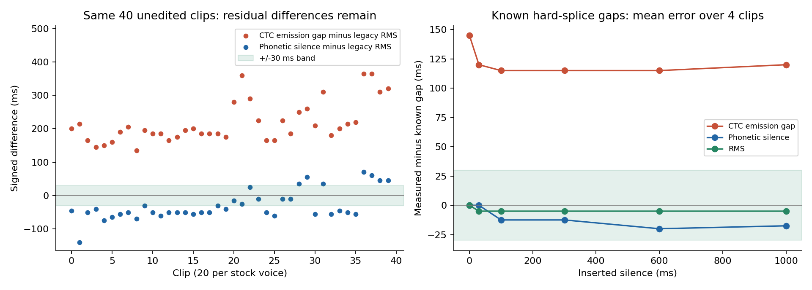
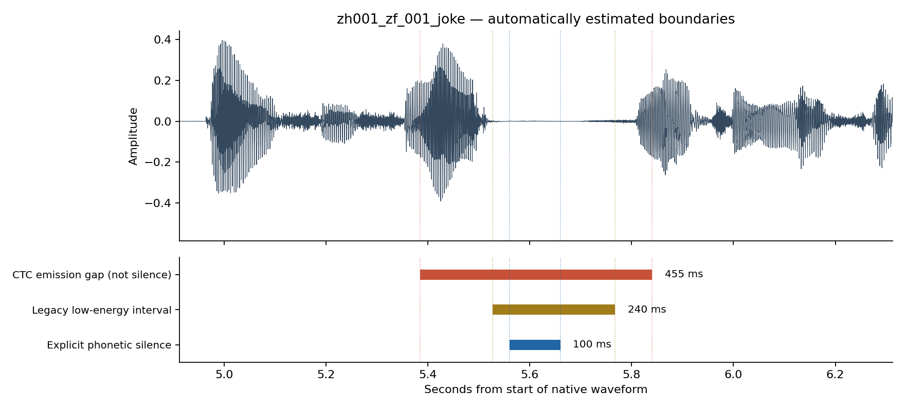
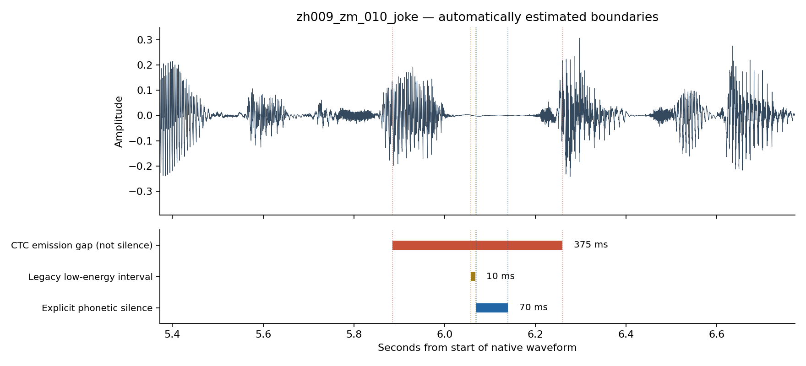

# Pause detector investigation — 2026-11-14

**The CTC measurement bug is fixed; full agreement on natural speech is not yet established.** The old code treated the interval between character-recognition spikes as silence. The corrected pause export measures explicit silence phones from a local phonetic aligner, checks the exact transcript boundary, and keeps CTC distances only as diagnostics. No constant 217 ms subtraction was applied.

On the same 40 clips, keeping the original RMS comparator fixed, mean signed disagreement changed from **+217.4 ms to -29.4 ms**; MAE fell from **217.4 to 47.9 ms**. Only 8/40 original-comparator differences are within 30 ms. The replacement therefore removes the large positive bias but does **not** meet a per-clip 30 ms agreement criterion.

The corrected export separately requires a unique waveform interval and agreement within 30 ms: **6/40 pass; 34/40 are flagged**, including ambiguous waveform cases. All 40 estimates and reasons remain saved. Do not run a humor comparison on this small selected subset or silently discard the flagged clips. Gate 1 remains unaccepted for natural-speech measurement confidence; no pilot/main run was launched.

## What the stronger tests established

The original insertion test measured only a change from baseline, so any fixed endpoint bias canceled. The new tests include 24 hard-spliced speech fixtures with exact gap lengths (four joke/control/voice combinations from one script), plus 72 incremental edits across three scripts, two voices and both endings. All use 0, 30, 100, 300, 600 and 1000 ms gaps. Both CTC and phonetic alignment were rerun from each edited waveform and its transcript; reference timestamps were not supplied to either aligner.

| Estimator | Absolute cases within 30 ms | Worst absolute error | Increment cases within 30 ms | Worst increment error |
|---|---:|---:|---:|---:|
| Legacy CTC emission gap | 0/24 | 155.0 ms | 72/72 | 20.0 ms |
| Phonetic silence (MFA) | 24/24 | 30.0 ms | 72/72 | 20.0 ms |
| Legacy RMS selection | 24/24 | 5.0 ms | 58/72 | 110.0 ms |
| RMS with ambiguity flags | 24/24 | 5.0 ms | 66/72 | 5.0 ms |
| Amplitude hysteresis | 24/24 | 5.0 ms | 72/72 | 0.0 ms |
| Pre-emphasized RMS | 24/24 | 30.0 ms | 72/72 | 5.0 ms |

The 6 missing incremental cases for ambiguity-aware RMS count as failures in the denominator. The original RMS selector sometimes latched onto a 5–10 ms dip and then jumped to a different interval after insertion. Its largest incremental error was 110 ms. The new selector reports multiple qualifying intervals as ambiguous rather than choosing whichever is closest to the midpoint. Truly adjacent spoken intervals remain zero; missing, noise-labelled, mismatched and overlapping alignments remain missing.

Hard-splice fixtures remove the original pause and weak edge speech, so their silence boundaries are exact by construction. They verify acoustic measurement on edited speech, **not** absolute phonetic boundary accuracy in intact natural speech. The HMM passed 96/96 edited-speech cases; that does not make it ground truth for the original clips.

## Independent checks and unsuccessful fixes

The fixed threshold grid was 25/30/35/40 dB below the clip’s 95th-percentile frame RMS. Hysteresis was specified before its comparison and worsened natural-clip agreement (89.5 ms MAE). A subsequent fixed 16 kHz, 0.97 pre-emphasis check handled low-frequency residue and recovered all 72 incremental edits, but still disagreed with the HMM by 59.5 ms MAE on the original clips. Neither was promoted based on agreement tuning. The full grid and missing counts are retained in the audit JSON.

Additional deterministic fixtures vary sample rate (16/24 kHz), signal amplitude (0.2/0.002), 60 dB-below-signal white noise and a DC offset. Pre-emphasized RMS passed all 72 cases within 30 ms. Raw RMS and hysteresis each passed 24/24 clean and 24/24 white-noise cases, but only 8/24 DC-offset cases. This is a waveform stress test, not an additional speech alignment result.

## Implementation and reproducibility

MFA 2.2.17 / Kaldi 5.5.1068 runs locally in a separate Windows environment. It uses the [Mandarin MFA v2.0.0a acoustic model](https://mfa-models.readthedocs.io/en/latest/acoustic/Mandarin/Mandarin%20MFA%20acoustic%20model%20v2_0_0a.html) and the [Mandarin (China) v2.0.0 pronunciation dictionary](https://mfa-models.readthedocs.io/en/latest/dictionary/Mandarin/Mandarin%20(China)%20MFA%20dictionary%20v2_0_0.html), attributed to Michael McAuliffe and Morgan Sonderegger, CC BY 4.0. Exact release URLs, SHA256s, Python dependencies and key native executable hashes are saved. No speaker adaptation, model training, fine-tuning or PostgreSQL server was used. Feature normalization is part of fixed inference.

The dictionary does not contain every individual character, so a deterministic minimum-token dictionary segmentation covers each setup and ending separately and preserves their shared boundary. All pronunciations are from the downloaded dictionary; no unknown-word substitutions were used. Pronunciation variants have equal weights and silence uses the model’s global prior, rather than word-specific silence probabilities. MFA receives a 16 kHz PCM16 resampled copy; original float waveforms remain unchanged.

Runtime logs confirm 25 ms MFCC windows / 10 ms shift, model-default dither=1 and pre-emphasis=0.97. The YAML dither=0 request was ignored by this MFA version because it reads acoustic-model metadata; the report records the actual setting. Only first-pass decoding ran. “Compiling training graphs” in the program log is transcript-graph construction, not model training. The GPU CTC pass remains local and unchanged apart from an explicit “not silence” type label.

The underlying CTC issue is also documented in [TorchAudio’s explanation of blank-token ambiguity](https://docs.pytorch.org/audio/stable/tutorials/ctc_forced_alignment_api_tutorial.html#inconsistent-treatment-of-blank-token). Peaky character emission supports do not specify complete acoustic durations. The independent HMM and waveform estimators differ in how they treat weak consonants, noise and transitions. Those residual differences are retained, not calibrated away using the comparison set.

One command per result: `python -m timing.measure_pauses` exports the corrected metric; `python -m timing.pause_audit --out pause-audit-v3` rebuilds natural-clip comparisons; `python -m timing.pause_evaluate --out pause-validation-v2` recomputes edited-speech recovery; `python -m timing.pause_noise` recomputes controlled-background results; `python -m timing.pause_report` rebuilds this report and its figures. Use the project `.venv/Scripts/python.exe`; see [README](../README.md) for model execution commands.

Artifacts: [corrected measurements](../runs/corrected-pauses-v1/metrics.json), [audit](../runs/pause-audit-v3/summary.json), [validation](../runs/pause-validation-v2/summary.json), [noise checks](../runs/pause-noise-v1/results.json), [pre-comparison decisions](../docs/pause-resolution-plan.md), and [local audio review page](pause-resolution-audio.html). No human annotation, billed API, new speech synthesis, system driver change or push was used in this continuation.
