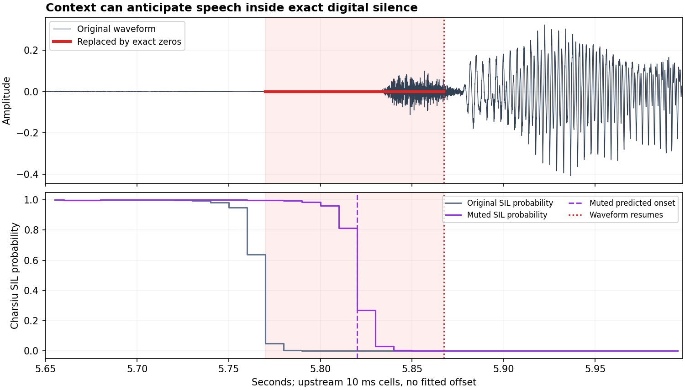
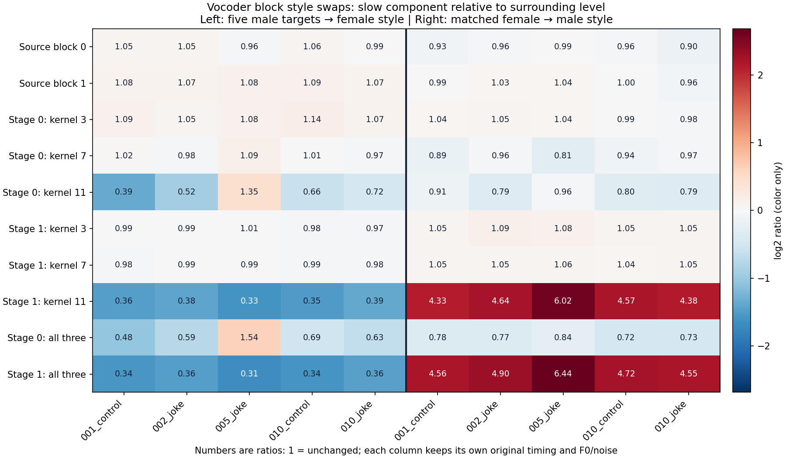
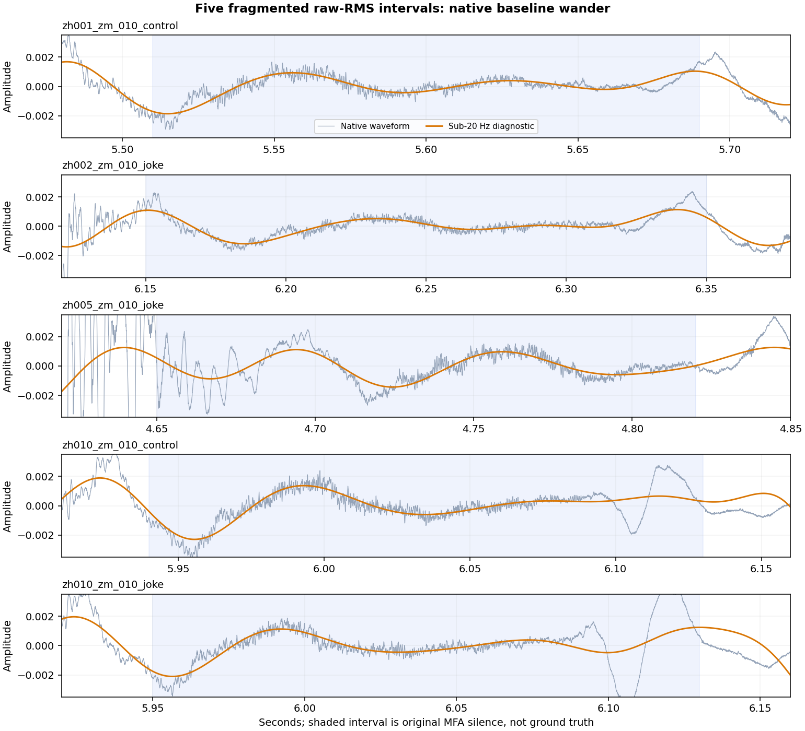

# Second aligner and source investigation

**Completed local exploration; original stimuli, primary estimates and all 34 flags are preserved.**

The new aligners corroborate an earlier phonetic onset in all 29 disputed clips.
That agreement is useful, but it does **not** establish 30 ms absolute accuracy:
all three phonetic models can anticipate speech inside deliberately muted audio.
The other five disagreements involve slow native Kokoro output that depends on
the decoder/style path. It is not introduced by resampling, and removing harmonic
excitation does not remove it. No candidate repair passed the broader validation
without limitations. Gate 1 remains unaccepted; no humor or main-study inference
was made. No human annotations, billed APIs, training or real-voice cloning.

[Per-clip plots and original audio](second-aligner-clips.html) include all 40 clips,
not only the 34 flagged ones. [Earlier investigation](flagged-followup.md) remains
available as the historical result. The original +217 ms CTC disagreement was a
different measurement-definition error; no constant offset is fitted here.

## What is corroborated about the 29 onsets

Both new methods agree with the original MFA ending onset within 30 ms in every
target. Setup endings are less consistent, so onset agreement must not be read as
agreement on the entire pause.

| New method versus original MFA | Onsets within 30 ms | Onset MAE | Largest onset difference | Setup ends within 30 ms |
|---|---:|---:|---:|---:|
| Charsiu frame classifier | 29/29 | 10.3 ms | 30.0 ms | 25/29 |
| New MFA Mandarin v3 | 29/29 | 10.0 ms | 20.0 ms | 24/29 |

All three onset estimates span at most 30 ms in 27/29 cases. The two `zh009_zf_001`
endings span 40 ms across the three models, despite each new model agreeing with
the original individually. Model ranges are descriptive, not confidence intervals.

Charsiu's unconstrained frame argmax assigns a non-silence class to every analysed
frame between original MFA onset and later RMS onset, across all 29 clips. Its
textless detector gives the same onset corroboration in 28/29. The exception,
`zh006_zf_001_joke`, has a 30 ms gap that the upstream four-frame minimum suppresses;
the predeclared two-frame sensitivity recovers 30 ms. This is a known minimum-length
effect, not an ambiguous interval. The textless method uses a broad existing search
bracket to localize the relevant boundary, but no transcript to classify frames.

**A falsification check limits this evidence.** Zeroing the disputed region with a
20 ms left guard, and separately extending the mute 40 ms past RMS onset, makes
Charsiu predict onset over 30 ms before waveform resumption in **29/29 cases in
both conditions**. Its convolutional waveform windows can be wholly inside zeros
while the full-context network predicts a phone. With the longer mute, original
MFA does this in 27/29 cases and newer MFA in
11/29. Muting removes speech while retaining the
transcript, so this is a context/phone-completion challenge, not proof that original
natural onsets are wrong. It does show why model agreement and posterior confidence
cannot serve as independent acoustic ground truth.

## Where the five low-frequency artifacts originate

All 40 native Kokoro waveforms were replayed bit-for-bit, and their inverse-STFT
reconstructions also matched. For the five targets, 24→16→24 kHz resampling changes
the sub-20-Hz diagnostic by at most 0.00038% RMS relative
to its original level. Actual PCM16 encoding changes it by at most
2.56%. All 40 actual encodings match the historical MFA input copies exactly;
a simple floor-quantizer approximation differs by up to one least-significant bit.
The component exists before either conversion.

| Clip | Native sub-20-Hz RMS | Correlation after noise-seed change | Retained after excitation zeroing | Retained after decoder-style swap |
|---|---:|---:|---:|---:|
| `zh001_zm_010_control` | 0.000696 | 0.989 | 97.0% | 41.1% |
| `zh002_zm_010_joke` | 0.000588 | 0.997 | 100.8% | 37.3% |
| `zh005_zm_010_joke` | 0.000716 | 0.997 | 107.2% | 79.9% |
| `zh010_zm_010_control` | 0.000896 | 0.985 | 96.2% | 35.5% |
| `zh010_zm_010_joke` | 0.000799 | 0.998 | 94.2% | 40.2% |

Predicted F0 is mostly below the source's 10 Hz voicing gate in these intervals;
raising that gate to 50 Hz barely changes the artifact. Zeroing the entire harmonic
excitation branch retains 94.2–107.2% of its RMS. Swapping only decoder
stock-voice style, while holding duration/F0/noise conditioning fixed, retains
35.5–79.9%. This supports a decoder/style-dependent residual; it does not identify
one faulty learned parameter or exclude every possible F0-conditioning effect.

A second intervention separates the decoder before the vocoder from style
conditioning inside the vocoder. Duration, F0 and noise conditioning stay fixed;
only existing stock-voice style components are exchanged. Native baselines replay
exactly. The following ranges cover the five artifact clips:

| Intervention | Retained sub-20-Hz RMS | Outside-gap waveform SNR versus original, dB |
|---|---:|---:|
| Vocoder style only | 19.2–50.5% | -2.07 to -1.86 |
| Pre-vocoder decoder style only | 100.4–162.1% | 4.17 to 5.85 |
| Vocoder style scale only | 30.4–60.3% | 0.31 to 1.02 |
| Vocoder style shift only | 62.2–80.4% | 2.15 to 2.75 |

The strongest reduction comes from vocoder style conditioning; changing only the
preceding decoder features does not reduce the slow component in these five cases.
Both scale and shift contribute. Applying the male vocoder style to the five
matched female clips increases this component by 2.1–2.9 times. These controlled
swaps localize a dependency, but speech changes substantially too: the SNR column
measures sample differences, not perceptual quality. They are not artifact repairs.

This effect is not explained by a simple overall gain reduction. With the same
outside-gap sample mask (100 ms margins), vocoder-style exchange raises surrounding
RMS by 12–16%. Dividing slow-component RMS changes by that level change leaves
17.0–43.6% of the original relative component.

A final 100-intervention audit exchanges style in each of eight residual blocks
and each of the two three-block waveform stages, for the five targets and five
matched reverse swaps. Own-style sham hooks reproduce all ten originals exactly.
The last stage's widest-kernel block (`resblocks.5`, kernel 11) alone leaves
32.7–38.6% of the relative slow component in every target. Reverse swaps increase it
4.3–6.0 times. Surrounding waveforms still change greatly (target SNR 0.5–0.8 dB).
The figure reports all groups, including weak and mixed effects. Such partial
stock-style combinations are outside the native conditioning pattern and effects
are not additive; this identifies a sensitive pathway, not a uniquely faulty layer.

The vocoder uses a 20-sample inverse FFT (1,200 Hz bin spacing). Summing individual
bin reconstructions reproduces native audio within floating-point tolerance. Its
slow component is almost entirely the residual of the lowest two synthesis-bin
contributions. Removing only the DC bin increases the artifact. These are
time-varying synthesis components, so deleting a bin is not a sub-20-Hz filter.
The style/source probes also change speech outside the gap and are not repairs.
The original 10–18 Hz peaks came from short windows; they do not establish a
stationary oscillator. Baseline wander is the more cautious description.

## Why the proposed corrections were not promoted

Per-frame mean subtraction (AC RMS) makes three of the five old ambiguous intervals
unique, leaves the two `zh010_zm_010` cases ambiguous, and introduces ambiguity in
`zh005_zm_010_control`. Linear detrending makes all 40 natural intervals unique.
Both retain the original 10 ms frame, 5 ms hop, −35 dB relative threshold, 20 ms
minimum and missing/ambiguity rules; no threshold was fitted to MFA.

They both pass the original 96 edited-speech cases. AC RMS also passes 480 controlled
tone/background cases, and linear detrending passes 576 including linear drift.
But linear detrending labels 16 non-silent 40–60 Hz probes at ≥−30 dB relative
amplitude as quiet, whereas raw and AC RMS do not. Across 27,196 model-labelled
phone-interior frames (20 ms margins), AC adds 421 quiet frames and linear detrending
adds 632. Those phone labels are diagnostic, not truth. More coverage is therefore
not evidence of better phonetic measurement. Natural gap MAE versus MFA increases
to 63.2 ms for AC and 66.5 ms for linear detrending.

## Recovery beyond the original fixture set

The original 24 absolute fixtures cut approximately 50–70 ms from the first ending
phone and 45–65 ms from the last setup phone, as estimated by original MFA. Their
digital silence is exact, but the original phonetic transcript no longer fully
describes the waveform. Charsiu passes 8/24 absolute cases and
68/72 increments. New MFA passes 22/24 and 72/72. Original MFA's historical
96/96 result remains true for that set and configuration.

A new held-out set uses six other scripts, both voices/endings, both edit types,
and the same six delays: 288 cases. The fixed cutting rules were retained. Each
method was run on the resulting waveform; timestamps were not merely shifted.
The broad search bracket is mapped through the known edit to provide localization.

| Method | Absolute within 30 ms /144 | Incremental within 30 ms /144 | Missing /288 | Largest observed error, ms |
|---|---:|---:|---:|---:|
| MFA2 | 129/144 | 144/144 | 0 | 70.0 |
| MFA3 | 79/144 | 143/144 | 0 | 70.0 |
| Charsiu | 74/144 | 141/144 | 0 | 50.0 |
| RMS_raw | 142/144 | 120/144 | 26 | 10.0 |
| RMS_AC | 141/144 | 126/144 | 21 | 20.0 |
| RMS_linear | 141/144 | 144/144 | 3 | 20.0 |
| Silero_0.3 | 99/144 | 139/144 | 0 | 120.0 |
| Silero_0.5 | 115/144 | 141/144 | 0 | 100.0 |
| Silero_0.7 | 122/144 | 144/144 | 0 | 100.0 |
| Silero_phase_0.5 | 128/144 | 144/144 | 0 | 100.0 |

The streaming [Silero v6.2.3 model](https://github.com/snakers4/silero-vad/releases/tag/v6.2.3)
was added as a past-context contrast to Charsiu. Raw threshold 0.5 passes 93/96 old
cases, and the predeclared 0.7 sensitivity passes 96/96; neither generalizes
perfectly to the new set. Averaging four fixed 0/8/16/24 ms chunk phases at threshold
0.5 improves quantization but also fails some cases. It is not a selected replacement.
All missing values count as failures. A zero estimate for a 30 ms insertion can
pass the requested tolerance, so pass counts alone overstate short-gap detection.
Hard-splice results test response to edited audio; they do not supply natural labels.

A separate implementation audit found that the old quiet-interval selector could
mark a bracket-edge blip missing before checking whether it met the 20 ms minimum.
Version 2 qualifies the whole run first. This fixes 4 fixture/method entries
across two zero-insertion clips and changes **none of the 40 natural estimates**.
Held-out totals become 264/288 for raw RMS, 268/288 for AC RMS and 286/288 for linear
RMS; the table above retains the originally run versions. The two remaining
linear-RMS failures are genuinely censored by the search bracket. No original
flag is cleared, and the quiet-speech caveat remains.

## Stability, implementation and reproducibility

All three aligners keep both boundaries within 30 ms of their own baseline after
7/100/500 ms leading padding, for all 40 intact recordings. A 0.1 gain is less
stable for MFA: original MFA gap MAE is 27.0 ms with a 110 ms maximum, newer MFA
19.3 ms with a 50 ms maximum; Charsiu is unchanged. Repeating original MFA with
zero dither reduces gain sensitivity to 11.5 ms MAE (40 ms maximum), but the earlier
zero-dither absolute-recovery failures remain. Zero dither is not promoted.
The gain challenge includes MFA's PCM16 copy and feature dither, so this is
sensitivity of the complete measurement pipeline, not just the learned weights.

Four fresh batches plus the saved baseline give five estimates per clip for each
MFA version. Across all 40 clips, the largest observed onset range is
20 ms for original MFA and 10 ms for newer MFA;
the largest gap range is 30 ms for both. These are observed repeat ranges, not
accuracy bounds or confidence intervals.

Estimator differences partly cancel in matched pairs, but not completely. Across
all 20 diagnostic script/voice pairs, switching from original MFA to newer MFA
changes the paired contrast by 13.5 ms on average in absolute value
(maximum 60 ms); switching to Charsiu changes it by
12.0 ms (maximum 40 ms). Raw RMS lacks a value for
4/20 pairs. These are differences between measurement methods with all flags
retained, not estimates of true error or a test of comedic timing.

Charsiu's 182 observed pinyin syllables match the pinned upstream preprocessing,
and all 40 DTW paths match upstream exactly. The adapter retains occurrence IDs to
avoid the upstream greedy repeated-phone word-mapping problem. Models were loaded
with no missing, unexpected or mismatched weights. No timestamp offset was fitted.
Charsiu's architecture differs from MFA, but automatically generated training
labels can share alignment assumptions; the Mandarin checkpoint's full training
provenance is not specified. See the [upstream code](https://github.com/lingjzhu/charsiu)
and [model card](https://huggingface.co/charsiu/zh_xlsr_fc_10ms).

MFA 3.0.7 and the official [Mandarin v3 acoustic model](https://mfa-models.readthedocs.io/en/latest/acoustic/Mandarin/Mandarin%20MFA%20acoustic%20model%20v3_0_0.html)
run in `.runtime/mfa3/`, separately from MFA 2. Two missing dictionary words received
automatic pronunciations from the matching official G2P model. `language: unknown`
disables re-tokenization of already dictionary-tokenized transcripts; the acoustic
model remains Mandarin. No adaptation, fine-tuning or database server was used.
Optional Conda test-file extraction hit Windows path limits; native components and
pinned wheels form the verified hybrid runtime. Failed attempts remain logged.

Licenses: MFA models/dictionaries are CC-BY-4.0 (McAuliffe and Sonderegger); Charsiu
code is MIT but checkpoint metadata does not state an explicit weight license, so
it stays a local exploratory dependency, not a redistributed asset. Silero's model
is MIT, [confirmed by its maintainer](https://github.com/snakers4/silero-vad/discussions/817).
The retained new model/native-download/cache inventory is approximately 2.95 GB,
below the approved 15 GB allowance; this is an artifact inventory, not a network
traffic meter. No system installation or driver change occurred.

Exact versions and hashes: `requirements-exploration-lock.txt`,
`requirements-mfa3-lock.txt`, `requirements-vad-lock.txt`, `runs/model-locks/`, and
`runs/exploration-environment-v1/`. All long inference runs checkpoint per clip or
aligner batch. A tuple/list manifest comparison bug was fixed without altering
stored scientific configurations. [Reproduction commands](../docs/second-aligner-reproduce.md)
cover each result; [the dated plan](../docs/second-aligner-plan.md) separates declared
tests from follow-ups motivated by their outcomes.

## Per-clip estimates (milliseconds)

These are exploratory estimates. Original eligibility is unchanged; the new
investigation status is separate from the original QC flag.

| Clip | Originally flagged | MFA2 | MFA3 | Charsiu | Raw RMS | Three-model onset span |
|---|---|---:|---:|---:|---:|---:|
| `zh001_zf_001_control` | yes | 170 | 110 | 150 | 215 | 20 |
| `zh001_zf_001_joke` | yes | 100 | 100 | 120 | 240 | 20 |
| `zh002_zf_001_control` | yes | 160 | 140 | 150 | 210 | 20 |
| `zh002_zf_001_joke` | yes | 170 | 130 | 150 | 210 | 10 |
| `zh003_zf_001_control` | yes | 250 | 250 | 200 | 325 | 30 |
| `zh003_zf_001_joke` | yes | 230 | 230 | 190 | 295 | 30 |
| `zh004_zf_001_control` | yes | 250 | 240 | 230 | 305 | 20 |
| `zh004_zf_001_joke` | yes | 260 | 250 | 220 | 310 | 30 |
| `zh005_zf_001_control` | yes | 110 | 100 | 110 | 180 | 30 |
| `zh005_zf_001_joke` | no | 110 | 80 | 120 | 140 | 20 |
| `zh006_zf_001_control` | yes | 60 | 60 | 60 | 110 | 20 |
| `zh006_zf_001_joke` | yes | 30 | 30 | 0 | 90 | 20 |
| `zh007_zf_001_control` | yes | 240 | 200 | 220 | 290 | 10 |
| `zh007_zf_001_joke` | yes | 190 | 160 | 170 | 240 | 20 |
| `zh008_zf_001_control` | yes | 270 | 230 | 250 | 320 | 10 |
| `zh008_zf_001_joke` | yes | 260 | 230 | 250 | 315 | 10 |
| `zh009_zf_001_control` | yes | 100 | 90 | 80 | 150 | 40 |
| `zh009_zf_001_joke` | yes | 100 | 80 | 80 | 150 | 40 |
| `zh010_zf_001_control` | no | 180 | 150 | 170 | 210 | 20 |
| `zh010_zf_001_joke` | yes | 180 | 150 | 170 | 220 | 10 |
| `zh001_zm_010_control` | yes | 180 | 160 | 220 | missing | 10 |
| `zh001_zm_010_joke` | no | 110 | 110 | 160 | 135 | 20 |
| `zh002_zm_010_control` | no | 150 | 160 | 180 | 125 | 20 |
| `zh002_zm_010_joke` | yes | 200 | 180 | 210 | missing | 10 |
| `zh003_zm_010_control` | yes | 240 | 240 | 230 | 290 | 20 |
| `zh003_zm_010_joke` | yes | 230 | 250 | 230 | 290 | 30 |
| `zh004_zm_010_control` | no | 280 | 240 | 270 | 290 | 20 |
| `zh004_zm_010_joke` | no | 280 | 240 | 280 | 290 | 20 |
| `zh005_zm_010_control` | yes | 140 | 130 | 170 | 105 | 20 |
| `zh005_zm_010_joke` | yes | 170 | 150 | 210 | missing | 0 |
| `zh006_zm_010_control` | yes | 50 | 40 | 80 | 105 | 20 |
| `zh006_zm_010_joke` | yes | 40 | 30 | 80 | 95 | 10 |
| `zh007_zm_010_control` | yes | 280 | 270 | 290 | 335 | 10 |
| `zh007_zm_010_joke` | yes | 290 | 270 | 290 | 335 | 20 |
| `zh008_zm_010_control` | yes | 290 | 270 | 300 | 340 | 0 |
| `zh008_zm_010_joke` | yes | 280 | 260 | 300 | 335 | 10 |
| `zh009_zm_010_control` | yes | 80 | 70 | 120 | 120 | 20 |
| `zh009_zm_010_joke` | yes | 70 | 90 | 110 | 115 | 20 |
| `zh010_zm_010_control` | yes | 190 | 180 | 210 | missing | 10 |
| `zh010_zm_010_joke` | yes | 180 | 190 | 220 | missing | 10 |
